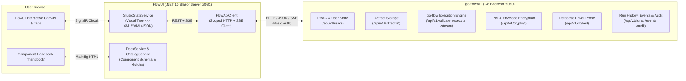

# FlowUI Compilation & `go-flowAPI` Architecture Guide

**FlowUI** is an interactive Blazor Server visual studio and management console for authoring, validating, encrypting, executing, and auditing ETL pipelines powered by the **`go-flowAPI`** backend engine.

---

## 1. Compiling, Running, and Publishing FlowUI

### Prerequisites
- **.NET 10.0 SDK** (`net10.0`) or later (`dotnet --version`)
- A running instance of **`go-flowAPI`** (defaults to `http://localhost:8080`)

### Restore & Compile (Debug / Release)
From the repository root (`flowUI/`):

```bash
# Restore NuGet dependencies
dotnet restore FlowUI/FlowUI.csproj

# Compile in Debug configuration
dotnet build FlowUI/FlowUI.csproj

# Compile in Release configuration
dotnet build FlowUI/FlowUI.csproj -c Release
```

> **Note:** All component and architecture Markdown guides under `FlowUI/Docs/**/*.md` are automatically embedded into the compiled assembly (`EmbeddedResource`) and copied to the output directory (`PreserveNewest`).

### Running in Development
```bash
dotnet run --project FlowUI/FlowUI.csproj
```
By default, FlowUI listens on `http://0.0.0.0:8081` (or `http://localhost:8081`).

### Publishing for Production
Framework-dependent deployment:
```bash
dotnet publish FlowUI/FlowUI.csproj -c Release -o ./publish
```

Self-contained single-binary deployment (no .NET runtime required on target machine):
```bash
# Linux (x64)
dotnet publish FlowUI/FlowUI.csproj -c Release -r linux-x64 --self-contained true -p:PublishSingleFile=true -o ./publish/linux-x64

# Windows (x64)
dotnet publish FlowUI/FlowUI.csproj -c Release -r win-x64 --self-contained true -p:PublishSingleFile=true -o ./publish/win-x64
```

---

## 2. Environment Variables (`AppConfig`)

`FlowUI` reads runtime configuration from environment variables at startup via `AppConfig`:

| Environment Variable | Default | Description |
| :--- | :--- | :--- |
| `FLOW_API_URL` | *(computed)* | Full base URL of `go-flowAPI` (e.g., `http://localhost:8080`). Overrides `FLOW_API_HOST` and `FLOW_API_PORT` when set. |
| `FLOW_API_HOST` | `localhost` | Hostname or IP address of `go-flowAPI` when `FLOW_API_URL` is not explicitly set. |
| `FLOW_API_PORT` | `8080` | TCP port of `go-flowAPI` when `FLOW_API_URL` is not explicitly set. |
| `FLOW_UI_PORT` | `8081` | UI port that the FlowUI Kestrel server binds to. Combined with `FLOW_UI_SCHEME`. |
| `FLOW_UI_SCHEME` | `https` | URL scheme for the FlowUI Kestrel binding. Set `FLOW_UI_SCHEME=http` to override the secure default in non-TLS local/dev environments. |
| `FLOW_UI_AUTH_MODE` | `basic` | Authentication mode (`none` / `off` / `false` / `disabled` to bypass login, or `basic` to require sign-in). |
| `FLOW_API_BASIC_AUTH` | *(empty)* | Optional `username:password` credential pair used for HTTP Basic Auth against `go-flowAPI` prior to interactive user sign-in. |
| `FLOW_UI_ADMIN_USER` | `admin` | Default bootstrap administrator username. |
| `FLOW_UI_ADMIN_PASSWORD` | `admin` | Default bootstrap administrator password. |

---

## 3. How FlowUI Relates to `go-flowAPI`

### Architectural Separation of Concerns
`FlowUI` is a **stateless presentation and authoring layer** built on ASP.NET Core Blazor Server (`InteractiveServer`). It does **not** execute ETL pipelines, manage database connection pools, or store persistent artifacts on its own local filesystem. Instead, `FlowUI` delegates all execution, persistence, cryptography, and telemetry operations to **`go-flowAPI`** over REST and Server-Sent Events (SSE).



### Subsystem Integration Details

#### 1. Authentication & Role-Based Access Control (RBAC)
- When a user logs into `FlowUI`, `StudioStateService` calls `FlowApiClient.AuthenticateUserAsync`, which attaches HTTP Basic Auth credentials (`Authorization: Basic ...`) to `GET /api/v1/users` on `go-flowAPI`.
- Based on the user record returned by `go-flowAPI` (or `403 Forbidden` for non-admin accounts that still pass authentication), `FlowUI` enforces RBAC permissions in the UI (`admin`, `operator`, `viewer`) and scopes subsequent `FlowApiClient` requests to that user's credentials.

#### 2. Two-Way Pipeline Serialization (`StudioStateService` + `PipelineSerializer`)
- `FlowUI` maintains an in-memory object graph (`PipelineModel`) representing `<preflight>`, `<variables>`, `<databases>`, and `<flow>` steps.
- `PipelineSerializer` converts this visual model back and forth into the canonical XML, YAML, or JSON pipeline specification understood by `go-flow` and `go-flowAPI`.
- Users can edit nodes visually in the **Visual Canvas** or edit raw source in the **Code Editor**, and `FlowUI` keeps both representations synchronized before submitting the payload to `go-flowAPI`.

#### 3. Server-Side Validation & Live SSE Execution
- **Validation (`POST /api/v1/validate`)**: Sends the serialized pipeline (`format` + `content`) to `go-flowAPI` to verify structural rules, component attributes, and DAG references.
- **Synchronous Execution (`POST /api/v1/execute`)**: Runs a pipeline to completion (or in `dry_run` mode) and returns structured step results, console logs, and final variable states.
- **Streaming Execution (`POST /api/v1/execute/stream`)**: Opens an HTTP `text/event-stream` (SSE) connection to `go-flowAPI`. As `go-flowAPI` executes each step, it emits `start`, `step`, `complete`, and `error` events that `FlowUI` renders live in the canvas and execution drawer.

#### 4. Artifact Storage & Lifecycle Management
- `FlowUI` stores and retrieves all reusable assets through `go-flowAPI`'s unified artifact store (`/api/v1/artifacts/{type}`):
  - `pipelines`: Saved ETL pipeline definitions
  - `schemas`: Reusable validation schemas
  - `templates`: Shared `<template>` / `<template_html>` bodies
  - `scripts`: Shared JavaScript/TypeScript `<script>` modules
  - `keys`: Public/private key material metadata

#### 5. Cryptography & Envelope Encryption
- To protect sensitive pipeline intellectual property or embedded credentials, `FlowUI` integrates with `go-flowAPI`'s cryptographic endpoints:
  - `POST /api/v1/crypto/keygen`: Generates RSA/ECDSA/Ed25519 key pairs.
  - `POST /api/v1/crypto/csr`: Generates Certificate Signing Requests.
  - `POST /api/v1/crypto/encrypt` & `POST /api/v1/crypto/decrypt`: Performs hybrid envelope encryption/decryption (`AES-256-GCM` payload encryption wrapped with RSA-OAEP).
  - Encrypted pipelines can be executed directly via `/api/v1/execute` by passing `encrypted: true` and the decryption key Reference/PEM.

#### 6. Database Connection Testing (`POST /api/v1/db/test`)
- When configuring `<database>` definitions in the **Canvas** or **Settings -> Database Connection Tester**, clicking **Test Connection** sends the driver (`postgres`, `mysql`, `sqlserver`, `oracle`, `sqlite`, `redis`, etc.) and DSN to `go-flowAPI` (`POST /api/v1/db/test`).
- `go-flowAPI` opens a live connection using its native Go database drivers, measures round-trip ping latency, and returns success or driver diagnostics to `FlowUI`, which updates the `✔ Tested` / `❌ Failed` status badge on the database node.

#### 7. Observability, Telemetry & Audit Logs
- **Dashboard & Telemetry**: `FlowUI` polls `/api/v1/health`, `/api/v1/runs`, and `/api/v1/events` on `go-flowAPI` to display historical run durations, step-level traces, and error rates.
- **Audit Log**: `FlowUI` queries `/api/v1/audit` to display an immutable trail of user logins, pipeline executions, artifact modifications, and administrative actions recorded by `go-flowAPI`.

---

## 4. Complete `FlowApiClient` <-> `go-flowAPI` Endpoint Reference

| Category | `FlowApiClient` Method | `go-flowAPI` Endpoint | Purpose |
| :--- | :--- | :--- | :--- |
| **Health** | `GetHealthAsync` | `GET /api/v1/health` | Service health check, version, and uptime |
| **Artifacts** | `ListArtifactsAsync` | `GET /api/v1/artifacts/{type}` | List stored `pipelines`, `schemas`, `templates`, `scripts`, or `keys` |
| **Artifacts** | `GetArtifactAsync` | `GET /api/v1/artifacts/{type}/{name}` | Load a specific artifact payload and metadata |
| **Artifacts** | `SaveArtifactAsync` | `PUT /api/v1/artifacts/{type}/{name}` | Create or update an artifact |
| **Artifacts** | `DeleteArtifactAsync` | `DELETE /api/v1/artifacts/{type}/{name}` | Delete an artifact |
| **Execution** | `ValidateAsync` | `POST /api/v1/validate` | Validate pipeline syntax, schema, and step configuration |
| **Execution** | `ExecuteAsync` | `POST /api/v1/execute` | Execute a pipeline (supports `dry_run`, runtime `variables`, and `encrypted` payloads) |
| **Execution** | `ExecuteStreamAsync` | `POST /api/v1/execute/stream` | Execute a pipeline with real-time Server-Sent Events (`text/event-stream`) |
| **Crypto / PKI** | `GenerateKeyPairAsync` | `POST /api/v1/crypto/keygen` | Generate cryptographic key pairs |
| **Crypto / PKI** | `GenerateCsrAsync` | `POST /api/v1/crypto/csr` | Generate a Certificate Signing Request (CSR) |
| **Crypto / PKI** | `EncryptPipelineAsync` | `POST /api/v1/crypto/encrypt` | Encrypt a pipeline using hybrid envelope encryption |
| **Crypto / PKI** | `DecryptPipelineAsync` | `POST /api/v1/crypto/decrypt` | Decrypt an encrypted pipeline envelope |
| **Telemetry** | `ListRunsAsync` | `GET /api/v1/runs` | List historical pipeline execution runs |
| **Telemetry** | `GetRunAsync` | `GET /api/v1/runs/{id}` | Get detailed step results and logs for a specific run |
| **Telemetry** | `ListEventsAsync` | `GET /api/v1/events` | Query telemetry events (optionally filtered by `run_id`) |
| **Audit** | `ListAuditLogsAsync` | `GET /api/v1/audit` | Retrieve security and operational audit logs |
| **Database** | `TestDbConnectionAsync` | `POST /api/v1/db/test` | Test live connectivity and measure latency for a database driver + DSN |
| **Users / RBAC** | `ListUsersAsync` | `GET /api/v1/users` | List registered users and roles |
| **Users / RBAC** | `SaveUserAsync` | `PUT /api/v1/users/{username}` | Create or update a user account, password, and role |
| **Users / RBAC** | `DeleteUserAsync` | `DELETE /api/v1/users/{username}` | Delete a user account |
