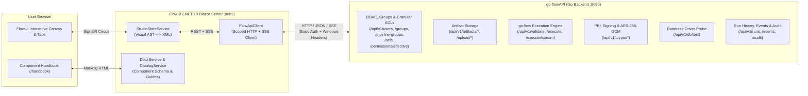

# FlowUI Compilation & `go-flowAPI` Architecture Guide (`v1.3.1`)

> **Version:** `FlowUI v1.3.1` & `go-flowAPI v1.3.1` | **Runtime:** `.NET 10.0` (`net10.0`)

**FlowUI** is an interactive Blazor Server visual studio and management console for authoring, validating, signing, encrypting, executing, governing (via granular pipeline ACLs), and auditing ETL pipelines powered by the **`go-flowAPI`** backend engine.

---

## 1. Compiling, Running, and Publishing FlowUI

### Prerequisites
- **.NET 10.0 SDK** (`net10.0`) or later (`dotnet --version`)
- A running instance of **`go-flowAPI`** (defaults to `http://localhost:8080`)

### Restore & Compile (Debug / Release)
From the repository root (`flowUI/`):

```bash
# Restore NuGet dependencies
dotnet restore FlowUI/FlowUI.csproj

# Compile in Debug configuration
dotnet build FlowUI/FlowUI.csproj

# Compile in Release configuration
dotnet build FlowUI/FlowUI.csproj -c Release
```

> **Note:** All component and architecture Markdown guides under `FlowUI/Docs/**/*.md` are automatically embedded into the compiled assembly (`EmbeddedResource`) and copied to the output directory (`PreserveNewest`).

### Running in Development
```bash
dotnet run --project FlowUI/FlowUI.csproj
```
By default, FlowUI listens on `http://0.0.0.0:8081` (or `http://localhost:8081`).

### Publishing for Production
Framework-dependent deployment:
```bash
dotnet publish FlowUI/FlowUI.csproj -c Release -o ./publish
```

Self-contained single-binary deployment (no .NET runtime required on target machine):
```bash
# Linux (x64)
dotnet publish FlowUI/FlowUI.csproj -c Release -r linux-x64 --self-contained true -p:PublishSingleFile=true -o ./publish/linux-x64

# Windows (x64)
dotnet publish FlowUI/FlowUI.csproj -c Release -r win-x64 --self-contained true -p:PublishSingleFile=true -o ./publish/win-x64
```

---

## 2. Environment Variables (`AppConfig`)

`FlowUI` reads runtime configuration from environment variables at startup via `AppConfig`:

| Environment Variable | Default | Description |
| :--- | :--- | :--- |
| `FLOW_API_URL` | *(computed)* | Full base URL of `go-flowAPI` (e.g., `http://localhost:8080`). Overrides `FLOW_API_HOST` and `FLOW_API_PORT` when set. |
| `FLOW_API_HOST` | `localhost` | Hostname or IP address of `go-flowAPI` when `FLOW_API_URL` is not explicitly set. |
| `FLOW_API_PORT` | `8080` | TCP port of `go-flowAPI` when `FLOW_API_URL` is not explicitly set. |
| `FLOW_UI_PORT` | `8081` | UI port that the FlowUI Kestrel server binds to. Combined with `FLOW_UI_SCHEME`. |
| `FLOW_UI_SCHEME` | `https` | URL scheme for the FlowUI Kestrel binding. Set `FLOW_UI_SCHEME=http` to override the secure default in non-TLS local/dev environments. |
| `FLOW_UI_AUTH_MODE` | `ApiBasic` | Active UI authentication mode (`ApiBasic` for interactive login against `go-flowAPI`, or `Windows` for Windows Integrated / AD identity). |
| `FLOW_API_BASIC_AUTH` | *(empty)* | Optional Base64 `username:password` service token used when `FLOW_UI_AUTH_MODE=Windows`. |
| `FLOW_UI_ADMIN_USER` | `admin` | Default bootstrap administrator username hint. |
| `FLOW_UI_ADMIN_PASSWORD` | `admin` | Default bootstrap administrator password hint. |

---

## 3. How FlowUI Relates to `go-flowAPI`

### Architectural Separation of Concerns
`FlowUI` is a **stateless presentation and authoring layer** built on ASP.NET Core Blazor Server (`InteractiveServer`). It does **not** execute ETL pipelines, manage database connection pools, or store persistent artifacts on its own local filesystem. Instead, `FlowUI` delegates all execution, persistence, access control, cryptography, and telemetry operations to **`go-flowAPI`** over REST and Server-Sent Events (SSE).



### Subsystem Integration Details

#### 1. Authentication, Global RBAC & Default-Strict Granular Pipeline ACLs (`v1.3.1`)
- When a user signs into `FlowUI` (`FlowApiPassthroughAuthProvider` or `WindowsIntegratedUiAuthProvider`), `FlowUI` verifies identity against `GET /api/v1/health` (sending `Authorization: Basic` and optional `X-Flow-Windows-User` + `X-Flow-Windows-Groups` headers) and maps the returned global role (`all`, `write`, `upload`, `execution-only`, `read-only`, or `scoped`).
- By default in `go-flowAPI v1.3.1` (`-strict-acl=true`), **all non-admin (`non-"all"`) accounts have zero access to pipelines if that account (or its API/AD groups) does not have explicit `allow` rules set in `dbo.flow_pipeline_acl`**.
- `FlowUI` queries `GET /api/v1/permissions/effective` and applies `FlowApiClient.ApplyEffectivePermissions` so non-admin users automatically receive their resolved group memberships and exact effective UI `CanCreate`, `CanRead`, `CanUpdate`, `CanDelete`, and `CanExecute` capabilities (revoking pipeline access when `strict_acl: true` and no ACLs grant access, unless the server explicitly opts out via `-strict-acl=false`).
- In **Settings → Backend API Users, Groups & ACLs**, administrators have 5 dedicated sub-tabs to manage **API Users** (`/api/v1/users`, defaulting new accounts to `scoped`), **User Groups** (`/api/v1/groups`), **Pipeline Groups** (`/api/v1/pipeline-groups` with explicit memberships and `name_pattern` globs such as `fin_*`), **Pipeline ACL Rules** (`/api/v1/acls` with `allow`/`deny` precedence), and the **Effective Permissions Inspector** (`/api/v1/permissions/effective` with `?username=` & `?groups=` simulation).

#### 2. Two-Way XML Pipeline Serialization (`XmlGeneratorService` & `XmlImporterService`)
- `FlowUI` maintains an in-memory AST (`PipelineDraft`) representing `<variables>`, `<databases>`, `<preflight>`, and `<flow>` steps.
- `XmlGeneratorService` and `XmlImporterService` convert this visual model back and forth into canonical `go-flow` XML (`pipeline`, `config`, and `options`), preserving cryptographic metadata and pipeline `Groups` memberships across load/save cycles.

#### 3. Server-Side Validation & Live SSE Execution
- **Validation (`POST /api/v1/validate`)**: Verifies XML structure, XSD rules, and component attributes without executing `<flow>` steps.
- **Synchronous Execution (`POST /api/v1/execute`)**: Runs a pipeline synchronously and returns structured step results, `formatted_output`, and `run_id`.
- **Streaming Execution (`POST /api/v1/execute/stream`)**: Opens an HTTP `text/event-stream` (SSE) stream and renders real-time `node_event` and `done` frames live in the Runner UI.

#### 4. Artifact Storage & Pipeline Group Assignment
- `FlowUI` manages `pipeline`, `config`, and `options` artifacts through `/api/v1/artifacts/{type}` (fetching each type independently so `403 Forbidden` on `config`/`options` for a `scoped` user never blocks authorized `pipeline` records from loading).
- Uploading or saving a `pipeline` supports optional `"groups"` assignment into `dbo.flow_pipeline_group_members`.

#### 5. Cryptography, `FLOWENC:v1:` Encryption & Digital Signatures
- Setting a session key in **Settings → Crypto** attaches `X-Flow-Secure-Key` for `FLOWENC:v1:` AES-256-GCM encryption/decryption.
- `/api/v1/crypto/keygen`, `/api/v1/crypto/sign`, `/api/v1/crypto/verify`, `/api/v1/crypto/encrypt`, and `/api/v1/crypto/decrypt` provide server-delegated OpenSSL PEM, PKCS#7 X.509 CMS, GPG/OpenPGP, and AES-256-GCM envelope operations (with local fallback via `FlowCryptoService`).

#### 6. Database Connection Testing & Observability
- **Database Tester (`POST /api/v1/db/test`)**: Pings the startup store or custom DSN and displays `connected`, latency, SQL `dialect`, `db_user`, and `spid`.
- **Logs & Audit (`/api/v1/runs`, `/api/v1/events`, `/api/v1/audit`)**: Displays run summaries, step-level `node_output` and session SPIDs, and API security/audit events.

---

## 4. Complete `FlowApiClient` <-> `go-flowAPI` Endpoint Reference

| Category | `FlowApiClient` Method | `go-flowAPI` Endpoint | Purpose |
| :--- | :--- | :--- | :--- |
| **Health & Identity** | `GetAuthenticatedIdentityAsync` / `CheckHealthAsync` | `GET /api/v1/health` | Service health, DB session identity, caller `permission` & `groups` |
| **Artifacts** | `ListArtifactsAsync` | `GET /api/v1/artifacts/{type}?include_content=true` | List readable `pipeline`, `config`, or `options` artifacts (includes pipeline `groups`) |
| **Artifacts** | `GetArtifactByIdAsync` | `GET /api/v1/artifacts/{type}/id/{id}?decrypt=true` | Fetch artifact by database `ID` (with `?decrypt=false` raw fallback) |
| **Artifacts** | `GetArtifactByNameAsync` | `GET /api/v1/artifacts/{type}/{name}?decrypt=true` | Fetch artifact by unique `name` (with `?decrypt=false` raw fallback) |
| **Artifacts** | `UpsertArtifactAsync` | `POST /api/v1/artifacts/{type}?upsert=true` | Create or overwrite an artifact (supports optional pipeline `groups`) |
| **Artifacts** | `UpdateArtifactByIdAsync` | `PUT /api/v1/artifacts/{type}/id/{id}` | Update an existing artifact by `ID` (supports optional pipeline `groups`) |
| **Artifacts** | `DeleteArtifactByIdAsync` | `DELETE /api/v1/artifacts/{type}/id/{id}` | Delete an artifact by database `ID` |
| **Artifacts** | `DeleteArtifactByNameAsync` | `DELETE /api/v1/artifacts/{type}/{name}` | Delete an artifact by unique `name` |
| **Execution** | `ValidatePipelineAsync` / `ValidatePipelineXmlAsync` | `POST /api/v1/validate` | Validate pipeline XML syntax, XSD schema, and AST semantics |
| **Execution** | `ExecutePipelineSyncAsync` | `POST /api/v1/execute` | Execute a pipeline synchronously (`file`, `file_xml`, `config`, `options`, `vars`, `node_output`) |
| **Execution** | `ExecutePipelineStreamAsync` | `POST /api/v1/execute/stream` | Execute a pipeline with live Server-Sent Events (`text/event-stream`) |
| **Crypto / PKI** | `CryptoKeygenAsync` | `POST /api/v1/crypto/keygen` | Generate Ed25519, ECDSA, RSA, X.509 PKCS#7, GPG, or AES-256 keys |
| **Crypto / PKI** | `CryptoSignAsync` | `POST /api/v1/crypto/sign` | Digitally sign XML payloads (`OPENSSL`, `PKCS7`, `PGP`) |
| **Crypto / PKI** | `CryptoVerifyAsync` | `POST /api/v1/crypto/verify` | Verify wrapped (`FLOWSIGNED:v1:`) or detached signatures |
| **Crypto / PKI** | `CryptoEncryptViaApiAsync` | `POST /api/v1/crypto/encrypt` | Encrypt payload into a `FLOWENC:v1:` AES-256-GCM envelope |
| **Crypto / PKI** | `CryptoDecryptViaApiAsync` | `POST /api/v1/crypto/decrypt` | Decrypt a `FLOWENC:v1:` AES-256-GCM envelope |
| **Telemetry** | `GetPipelineRunsAsync` | `GET /api/v1/runs` | Query historical pipeline execution summaries (`dbo.pipeline_runs`) |
| **Telemetry** | `GetPipelineEventsAsync` | `GET /api/v1/events` | Query step-level execution telemetry & `node_output` (`dbo.pipeline_events`) |
| **Audit** | `GetApiAuditLogsAsync` | `GET /api/v1/audit` | Query API security & operational audit events (`dbo.flow_api_events`) |
| **Database** | `TestDatabaseViaApiAsync` | `POST /api/v1/db/test` | Test live connectivity and measure latency for default store or custom DSN |
| **API Users** | `GetApiUsersAsync` | `GET /api/v1/users` | List registered API users, global roles, and `groups` |
| **API Users** | `UpsertApiUserAsync` | `POST /api/v1/users` | Create or update an API user (`all`, `scoped`, `write`, `upload`, `execution-only`, `read-only`) and `groups` |
| **API Users** | `DeleteApiUserAsync` | `DELETE /api/v1/users/{username}` | Delete an API user account |
| **User Groups** | `GetApiGroupsAsync` | `GET /api/v1/groups` | List API user groups and their members (`dbo.flow_api_groups`) |
| **User Groups** | `UpsertApiGroupAsync` | `POST /api/v1/groups` | Create or update an API user group and member list |
| **User Groups** | `DeleteApiGroupAsync` | `DELETE /api/v1/groups/{name}` | Delete an API user group |
| **User Groups** | `AddApiGroupMembersAsync` | `POST /api/v1/groups/{name}/members` | Add user(s) to an API user group (`dbo.flow_api_user_groups`) |
| **User Groups** | `RemoveApiGroupMemberAsync` | `DELETE /api/v1/groups/{name}/members/{username}` | Remove a user from an API user group |
| **Pipeline Groups** | `GetPipelineGroupsAsync` | `GET /api/v1/pipeline-groups` | List pipeline groups, `name_pattern` globs, and matched pipelines |
| **Pipeline Groups** | `UpsertPipelineGroupAsync` | `POST /api/v1/pipeline-groups` | Create or update a pipeline group (`name_pattern` + explicit `pipelines`) |
| **Pipeline Groups** | `DeletePipelineGroupAsync` | `DELETE /api/v1/pipeline-groups/{name}` | Delete a pipeline group |
| **Pipeline Groups** | `AddPipelinesToGroupAsync` | `POST /api/v1/pipeline-groups/{name}/pipelines` | Assign pipeline(s) to a pipeline group (`dbo.flow_pipeline_group_members`) |
| **Pipeline Groups** | `RemovePipelineFromGroupAsync` | `DELETE /api/v1/pipeline-groups/{name}/pipelines/{pipeline}` | Remove an explicit pipeline membership from a group |
| **Pipeline ACLs** | `GetPipelineAclsAsync` | `GET /api/v1/acls` | List granular `allow`/`deny` pipeline ACL rules (optional principal/target filters) |
| **Pipeline ACLs** | `UpsertPipelineAclAsync` | `POST /api/v1/acls` | Create or upsert a granular pipeline ACL rule (`dbo.flow_pipeline_acl`) |
| **Pipeline ACLs** | `UpdatePipelineAclAsync` | `PUT /api/v1/acls/{id}` | Update an existing pipeline ACL rule by primary key `ID` |
| **Pipeline ACLs** | `DeletePipelineAclAsync` | `DELETE /api/v1/acls/{id}` | Delete a pipeline ACL rule by `ID` |
| **Effective Perms** | `GetEffectivePermissionsAsync` | `GET /api/v1/permissions/effective` | Inspect effective per-pipeline CRUD & Execute rights (supports `?username=&groups=` simulation for admins) |
