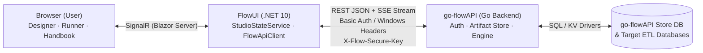

# FlowUI (Flow Builder Studio)

**FlowUI** is an interactive .NET 10 Blazor Server web application (**Flow Builder Studio**) for visually designing, configuring, signing, encrypting, validating, executing, and monitoring XML ETL pipelines powered by **`go-flow`** and **`go-flowAPI`**.

---

## 1. Prerequisites & Dependencies

- **.NET SDK**: `.NET 10.0 SDK` (`net10.0`) or newer
- **Running Backend**: A running instance of **`go-flowAPI`** (for persistence, pipeline validation/execution, user management, and telemetry)
- **NuGet Packages** (restored automatically during build):
  - `Radzen.Blazor` (`12.1.5`) — UI components
  - `Markdig` (`0.40.0`) — Markdown rendering for component guides and the `/handbook`
  - `System.Security.Cryptography.Pkcs` (`10.0.13`) — Local X.509 / PKCS#7 CMS signing & verification fallback

> **Embedded Documentation**: All Markdown guides under `FlowUI/Docs/**/*.md` are compiled into `FlowUI.dll` as `<EmbeddedResource>` items and copied to the output directory (`PreserveNewest`), so component guides and the `/handbook` work even in single-directory or container deployments.

---

## 2. How to Compile, Run, and Publish FlowUI

All commands below are run from the repository root (`flowUI/`).

### Restore & Compile (Debug)
```powershell
dotnet restore FlowUI/FlowUI.csproj
dotnet build FlowUI/FlowUI.csproj
```

### Compile for Release
```powershell
dotnet build FlowUI/FlowUI.csproj -c Release
```

### Run Locally in Development
```powershell
# Set the target go-flowAPI URL and UI port, then launch:
$env:FLOW_API_URL = "http://localhost:8080"
$env:FLOW_UI_PORT = "5080"
dotnet run --project FlowUI/FlowUI.csproj
```

### Publish for Deployment
Framework-dependent deployment (requires .NET 10 ASP.NET Core Runtime on target host):
```powershell
dotnet publish FlowUI/FlowUI.csproj -c Release -o ./publish
```

Self-contained deployment (bundles the .NET 10 runtime for Windows `win-x64` or Linux `linux-x64`):
```powershell
# Windows x64
dotnet publish FlowUI/FlowUI.csproj -c Release -r win-x64 --self-contained true -o ./publish/win-x64

# Linux x64
dotnet publish FlowUI/FlowUI.csproj -c Release -r linux-x64 --self-contained true -o ./publish/linux-x64
```

---

## 3. Environment Variables & Configuration (`AppConfig`)

`FlowUI` is configured through environment variables read by [`AppConfig.cs`](FlowUI/Config/AppConfig.cs):

| Environment Variable | Default | Description |
| :--- | :--- | :--- |
| `FLOW_API_URL` | `""` | Full base URL of `go-flowAPI` (e.g., `http://localhost:8080`). Takes precedence over `FLOW_API_HOST` / `FLOW_API_PORT`. |
| `FLOW_API_HOST` | `""` | Hostname or scheme+host of `go-flowAPI` (e.g., `localhost` or `https://flow-api.internal`) if `FLOW_API_URL` is not set. |
| `FLOW_API_PORT` | `""` | Port of `go-flowAPI` (e.g., `8080`) combined with `FLOW_API_HOST`. |
| `FLOW_UI_PORT` | `""` | HTTP port that `FlowUI` binds to (binds `http://localhost:<port>` locally, or `http://0.0.0.0:<port>` when `DOTNET_RUNNING_IN_CONTAINER=true`). Ignored if `ASPNETCORE_URLS` is explicitly set. |
| `FLOW_UI_AUTH_MODE` | `"ApiBasic"` | Active UI authentication mode: `ApiBasic` (interactive login against `go-flowAPI`) or `Windows` (Windows Integrated / AD identity). |
| `FLOW_API_BASIC_AUTH` | `""` | Optional Base64 `user:password` service token used only when `FLOW_UI_AUTH_MODE=Windows`. |
| `FLOW_UI_ADMIN_USER` | `""` | Optional bootstrap admin username hint. |
| `FLOW_UI_ADMIN_PASSWORD` | `""` | Optional bootstrap admin password hint. |

---

## 4. How FlowUI Relates to `go-flowAPI`

### Architectural Separation of Concerns

`FlowUI` is **strictly a stateless visual studio and orchestration frontend**. It does **not** connect directly to any application database or execute ETL steps inside the .NET process. Instead, every persistence, validation, execution, database ping, and audit operation flows over HTTP/REST to **`go-flowAPI`**:



| Layer | Responsibility |
| :--- | :--- |
| **FlowUI (`.NET 10 Blazor Server`)** | • Visual AST node tree editor (`<variables>`, `<databases>`, `<preflight>`, `<flow>`)<br>• Bidirectional XML generator (`XmlGeneratorService`) & XML importer (`XmlImporterService`)<br>• 26-component catalog (`CatalogService`) mirroring `go-flow/builder/catalog.go`<br>• Searchable Component Guide Handbook (`/handbook`) with Markdig + Mermaid<br>• Client-side/session AES-256-GCM (`FLOWENC:v1:`) & PKI helper (`FlowCryptoService`)<br>• Scoped session coordinator (`StudioStateService`) & HTTP client (`FlowApiClient`) |
| **go-flowAPI (`Go REST Service`)** | • Persistent storage of `pipeline`, `config`, and `options` artifacts<br>• Server-side XML validation (`/api/v1/validate`) and ETL execution (`/api/v1/execute`)<br>• Real-time Server-Sent Events (SSE) execution streaming (`/api/v1/execute/stream`)<br>• User & RBAC management (`dbo.flow_api_users` via `/api/v1/users`)<br>• Execution run history (`/api/v1/runs`), step events (`/api/v1/events`), and API audit logs (`/api/v1/audit`)<br>• Database connectivity testing (`/api/v1/db/test`) and server-side crypto (`/api/v1/crypto/*`) |

---

### Complete `FlowUI` ↔ `go-flowAPI` Endpoint Mapping

All backend communication is encapsulated in [`FlowApiClient.cs`](FlowUI/Services/FlowApiClient.cs):

#### 1. Health, Identity & Authentication
- **`GET /api/v1/health`** (`GetAuthenticatedIdentityAsync` / `CheckHealthAsync`):
  - Verifies backend connectivity, database dialect, `db_user`, `authenticated_as`, and the caller's effective `permission` level.
  - **Authentication Headers Sent by `FlowUI`**:
    - **API Basic Mode (`ApiBasic`)**: Sends `Authorization: Basic <base64(username:password)>` from the user's interactive login.
    - **Windows Integrated Mode (`Windows`)**: Sends `Authorization: Basic`, `X-Flow-Windows-User: <DOMAIN\user>`, and `X-Flow-Windows-Groups: <base64(json-groups)>` so `go-flowAPI` can match the user or their AD groups against `dbo.flow_api_users`.
  - **RBAC Permission Mapping (`FlowApiClient.MapApiPermissionToUser`)**:
    - `read-only` → **Read (`R`)**
    - `execution-only` → **Read + Execute (`R · EXEC`)**
    - `upload` / `write` → **Create, Read, Update, Delete + Execute (`C · R · U · D · EXEC`)**
    - `all` / `admin` → **Full Administrator (`ADMIN`, including `/api/v1/users` management)**

#### 2. Artifact Storage (`pipeline`, `config`, `options`)
`FlowUI` manages three artifact types in `go-flowAPI`:
1. **`pipeline`** (`<pipeline>` XML — full ETL workflow)
2. **`config`** (`<pipeline>` XML restricted to setup/preflight/config-allowed components)
3. **`options`** (`<flow_cli_options>` XML — reusable CLI flag sets such as `--var`, `--config`, `--timeout`)

| Operation | `go-flowAPI` Endpoint | `FlowApiClient` Method |
| :--- | :--- | :--- |
| List artifacts by type | `GET /api/v1/artifacts/{type}?include_content=true` | `ListArtifactsAsync` |
| Get artifact by ID | `GET /api/v1/artifacts/{type}/id/{id}?decrypt=true` | `GetArtifactByIdAsync` |
| Get artifact by Name | `GET /api/v1/artifacts/{type}/{name}?decrypt=true` | `GetArtifactByNameAsync` |
| Create / Upsert artifact | `POST /api/v1/artifacts/{type}?upsert=true` | `UpsertArtifactAsync` |
| Update artifact by ID | `PUT /api/v1/artifacts/{type}/id/{id}` | `UpdateArtifactByIdAsync` |
| Delete artifact by ID | `DELETE /api/v1/artifacts/{type}/id/{id}` | `DeleteArtifactByIdAsync` |
| Delete artifact by Name | `DELETE /api/v1/artifacts/{type}/{name}` | `DeleteArtifactByNameAsync` |

> **Encrypted Artifact Fallback**: When loading an artifact by ID or name, `FlowUI` first requests `?decrypt=true` (passing `X-Flow-Secure-Key` if configured in the session). If server-side decryption fails because the artifact uses a custom passphrase, `FlowUI` automatically falls back to `?decrypt=false` to retrieve the raw `FLOWENC:v1:` ciphertext and prompts the user to unlock it locally.

#### 3. Pipeline Validation & Execution (Sync + Real-Time SSE Stream)
From the **Runner** or **Pipeline Designer** tabs, `FlowUI` packages the active `PipelineXml`, optional `ConfigXml`, optional `OptionsXml` / CLI flags, and runtime variables into an `ExecutePipelineRequest`:
- **`POST /api/v1/validate`** (`ValidatePipelineAsync`): Validates XML syntax, schema, and component attributes without executing side effects (`validate_only: true`).
- **`POST /api/v1/execute`** (`ExecutePipelineSyncAsync`): Runs the pipeline synchronously and returns the full `ExecutePipelineResponse` (`run_id`, `status`, `duration_ms`, `formatted_output`, `results`, `events`).
- **`POST /api/v1/execute/stream`** (`ExecutePipelineStreamAsync`): Sends `Accept: text/event-stream` and consumes real-time Server-Sent Events (`event: node` / `event: done`) as each node starts, completes, or fails, updating the Runner UI live.

#### 4. Cryptography, Encryption & Digital Signatures
`FlowUI` supports both server-delegated crypto (`go-flowAPI`) and local .NET cryptographic operations (`FlowCryptoService`):
- **Session Secure Key**: Setting a session key in **Settings → Crypto** attaches the `X-Flow-Secure-Key` HTTP header to `go-flowAPI` requests for `FLOWENC:v1:` (PBKDF2-HMAC-SHA256 + AES-256-GCM) encryption/decryption.
- **`POST /api/v1/crypto/keygen`** (`CryptoKeygenAsync`): Generates Ed25519, ECDSA P-256/P-384, RSA-2048/4096, X.509 PKCS#7, or GPG keypairs (falls back to `FlowCryptoService.GenerateKeyPairLocal` if offline).
- **`POST /api/v1/crypto/sign`** (`CryptoSignAsync`) & **`POST /api/v1/crypto/verify`** (`CryptoVerifyAsync`): Signs and verifies XML artifacts using OpenSSL PEM, PKCS#7 CMS/X.509, or GPG envelopes.
- **`POST /api/v1/crypto/encrypt`** & **`POST /api/v1/crypto/decrypt`**: Encrypts or decrypts payload strings via `go-flowAPI`.

#### 5. Telemetry, Execution History & Audit Logs
Displayed in the **Logs** tab:
- **`GET /api/v1/runs?limit=150&status=...`** (`GetPipelineRunsAsync`): Lists historical pipeline runs stored by `go-flowAPI`.
- **`GET /api/v1/events?run_id={runId}&limit=500`** (`GetPipelineEventsAsync`): Fetches per-node execution telemetry for a specific run.
- **`GET /api/v1/audit?limit=200`** (`GetApiAuditLogsAsync`): Fetches backend HTTP/API audit trail events.

#### 6. Database Connection Testing & User Administration
Displayed in the **Settings** tab:
- **`POST /api/v1/db/test`** (`TestDatabaseViaApiAsync`): Sends a connection string/DSN (or empty string to test `go-flowAPI`'s default store) and returns connection status (`connected`), round-trip latency (`latency_ms`), SQL dialect, `db_user`, and session `spid`.
- **`GET /api/v1/users`**, **`POST /api/v1/users`**, **`DELETE /api/v1/users/{username}`**: Manages `go-flowAPI` users, AD group mappings, and permission levels.
