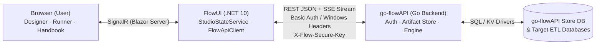

# FlowUI (Flow Builder Studio `v1.4.1`)

> **Version:** `1.4.1` | **Target Runtime:** `.NET 10.0` (`net10.0`) | **Companion Backend:** `go-flowAPI v1.4.1` | **Release Notes:** [`RELEASE_NOTES.md`](./RELEASE_NOTES.md)

**FlowUI** is an interactive .NET 10 Blazor Server web application (**Flow Builder Studio**) for visually designing, configuring, signing, encrypting, validating, executing, and monitoring XML ETL pipelines powered by **`go-flow`** and **`go-flowAPI`**.

## What's New in `v1.4.1`

- **Reusable Pipeline, Options & Config Templates (`TemplatesTab.razor`, `PipelineDesignerTab.razor`, `TemplateActionModal.razor`)**:
  - Save any Pipeline, Config, or Options draft as a reusable template, edit templates in the Visual Designer (with a clear Template Mode banner and Run disabled), and save templates as live Pipeline, Config, or Options artifacts.
  - Displays template **Author (`CreatedBy`)**, **Created (UTC)**, and **Updated (UTC)** timestamps; users see only their own templates unless granted `template-viewer`, `template-admin`, or `all` in Settings.
- **Database Server Telemetry in Logs (`LogsTab.razor`, `EventDetailModal.razor`, `TelemetryModels.cs`)**:
  - **Pipeline Runs**: Added a **Log DB Server** column displaying the database server/catalog where run telemetry is logged (e.g., `T15P/PROTO` or `sqlite:flow_api.db`).
  - **Step Execution Events**: Added a **DB Server** column alongside **DB User / SPID** showing the database server for each step's SPID.
  - **Cross-Database `sql_bulk` Source > Target Formatting**: Automatically formats cross-database `sql_bulk` events as `source > target` for database server (`SRCSRV/SRCDB > TGTSRV/TGTDB`), DB user, and SPID (`54 > 61`), both in the events grid and the step event detail modal.
- **Updated Connection String Documentation (`FlowUI/Docs/database_connection_strings.md`)**: Documented Unix Kerberos (`authenticator=krb5`, `krb5-*`, `ServerSPN`) parameters, `kinit` / CLI examples, and Unix SQL Server authentication mode selection (`SQL Auth` vs `NTLM` vs `Kerberos`).

### Previous Highlights (`v1.3.1`–`v1.3.2`)

- **5-Sub-Tab Access Control Workspace in Settings**:
  1. **API Users (`/api/v1/users`)**: Create/manage users and group assignments; new non-admin users default to `scoped` (zero implicit pipeline access until granted ACLs).
  2. **User Groups (`/api/v1/groups`)**: Manage API user groups (`dbo.flow_api_groups`) and add/remove members (`dbo.flow_api_user_groups`).
  3. **Pipeline Groups (`/api/v1/pipeline-groups`)**: Manage logical pipeline groups (`dbo.flow_pipeline_groups`) combining case-insensitive `name_pattern` globs (e.g., `fin_*`) and explicit pipeline assignments (`dbo.flow_pipeline_group_members`).
  4. **Pipeline ACL Rules (`/api/v1/acls`)**: Author user- and group-level `allow` / `deny` rules for `create`, `read`, `update`, `delete`, `execute`, and `all` across individual pipelines, pipeline groups, or wildcard `*`.
  5. **Effective Permissions Inspector (`/api/v1/permissions/effective`)**: Null-safe live permission matrix displaying resolved groups, `strict_acl` status, `creatable_groups`, `can_create_ungrouped`, `can_execute_inline_xml`, and per-pipeline `C · R · U · D · EXEC` badges — with admin user inspection (`?username=...`) and AD/external group "what-if" simulation (`?groups=...`).
- **Default Strict Pipeline ACL Enforcement (`strict_acl: true`)**: Non-admin accounts have **no access to pipelines by default** unless granted via explicit `allow` rules in `dbo.flow_pipeline_acl`. `FlowApiClient.ApplyEffectivePermissions` dynamically hydrates UI `CanCreate`, `CanRead`, `CanUpdate`, `CanDelete`, and `CanExecute` controls from `/api/v1/permissions/effective`.
- **Pipeline Group Assignment in Designer & Upload Modal**: Assign pipelines to one or more pipeline groups directly when saving from the Designer or uploading XML files in `LocalFileUploadModal`.

---

## 1. Prerequisites & Dependencies

- **.NET SDK**: `.NET 10.0 SDK` (`net10.0`) or newer
- **Running Backend**: A running instance of **`go-flowAPI`** (for persistence, pipeline validation/execution, user management, and telemetry)
- **NuGet Packages** (restored automatically during build):
  - `Radzen.Blazor` (`12.1.5`) — UI components
  - `Markdig` (`0.40.0`) — Markdown rendering for component guides and the `/handbook`
  - `System.Security.Cryptography.Pkcs` (`10.0.13`) — Local X.509 / PKCS#7 CMS signing & verification fallback

> **Embedded Documentation**: All Markdown guides under `FlowUI/Docs/**/*.md` are compiled into `FlowUI.dll` as `<EmbeddedResource>` items and copied to the output directory (`PreserveNewest`), so component guides and the `/handbook` work even in single-directory or container deployments.

---

## 2. How to Compile, Run, and Publish FlowUI

All commands below are run from the repository root (`flowUI/`).

### Restore & Compile (Debug)
```powershell
dotnet restore FlowUI/FlowUI.csproj
dotnet build FlowUI/FlowUI.csproj
```

### Compile for Release
```powershell
dotnet build FlowUI/FlowUI.csproj -c Release
```

### Run Locally in Development
```powershell
# Set the target go-flowAPI URL and UI port, then launch:
$env:FLOW_API_URL = "http://localhost:8080"
$env:FLOW_UI_PORT = "5080"
# Optional: override default HTTPS binding for local HTTP usage
$env:FLOW_UI_SCHEME = "http"
dotnet run --project FlowUI/FlowUI.csproj
```

### Publish for Deployment
Framework-dependent deployment (requires .NET 10 ASP.NET Core Runtime on target host):
```powershell
dotnet publish FlowUI/FlowUI.csproj -c Release -o ./publish
```

Self-contained deployment (bundles the .NET 10 runtime for Windows `win-x64` or Linux `linux-x64`):
```powershell
# Windows x64
dotnet publish FlowUI/FlowUI.csproj -c Release -r win-x64 --self-contained true -o ./publish/win-x64

# Linux x64
dotnet publish FlowUI/FlowUI.csproj -c Release -r linux-x64 --self-contained true -o ./publish/linux-x64
```

---

## OS Packaging, Installation & Background Services (`/opt/flow-ui` & Windows WinGet / SCM)

Build scripts, package manifests, OS service units (`systemd`, OpenRC, SysVinit, FreeBSD `rc.d`, OpenBSD `rc.d`, macOS `launchd`, and native Windows Service helpers), `man` pages, GNU `info` documentation, WiX `.msi` definitions, and WinGet manifests are located in [`packaging/`](packaging/README.md).

Packages use non-colliding identifiers (**`flow-ui`** on Unix, **`ETLMadness.FlowUI`** on WinGet) and install isolated under **`/opt/flow-ui`** (or `C:\Program Files\ETL Madness\Flow UI\`) so they can run side-by-side with `go-flow` (`/opt/flow`) and `go-flowAPI` (`/opt/flow-api`) with zero file collisions:

| Target Platform | Package Format | Build Script | Install Command | OS Service / `rc` Integration |
| :--- | :--- | :--- | :--- | :--- |
| **Debian / Ubuntu** | `.deb` *(self-contained)* | `sh ./packaging/scripts/build-deb.sh [amd64\|arm64]` | `sudo apt install ./packaging/dist/flow-ui_*.deb` | `systemd` (`flow-ui.service`), OpenRC & SysVinit |
| **RHEL / Fedora / SUSE / openSUSE** | `.rpm` *(self-contained)* | `sh ./packaging/scripts/build-rpm.sh [amd64\|arm64]` | `sudo dnf install ./packaging/dist/flow-ui-*.rpm` *(or `zypper`)* | `systemd` (`flow-ui.service`), OpenRC & SysVinit |
| **Arch Linux** | `.pkg.tar.zst` *(self-contained)* | `sh ./packaging/scripts/build-arch.sh [amd64\|arm64]` | `sudo pacman -U ./packaging/dist/flow-ui-*.pkg.tar.zst` | `systemd` (`flow-ui.service`) |
| **macOS** | `.pkg` *(self-contained)* | `sh ./packaging/scripts/build-macos-pkg.sh [arm64\|amd64]` | `sudo installer -pkg ./packaging/dist/flow-ui-*.pkg -target /` | `launchd` (`com.etlmadness.flow-ui.plist`) |
| **FreeBSD** | `.pkg` *(requires `pkg install dotnet`)* | `sh ./packaging/scripts/build-freebsd-pkg.sh [amd64\|arm64]` | `sudo pkg add ./packaging/dist/flow-ui-*.pkg` | `rc.d` (`/usr/local/etc/rc.d/flow_ui` + `sysrc`) |
| **OpenBSD** | `.tgz` *(framework-dependent)* | `sh ./packaging/scripts/build-openbsd-pkg.sh [amd64\|arm64]` | `doas pkg_add -D unsigned ./packaging/dist/openbsd-amd64/flow-ui-*.tgz` | `rc.d` (`/etc/rc.d/flow_ui` + `rcctl`; requires custom `dotnet`) |
| **Windows (WinGet Portable)** | `.zip` + WinGet YAML *(self-contained)* | `.\packaging\scripts\Build-Windows.ps1 -Format zip` | `winget install --manifest packaging\dist\winget\e\ETLMadness\FlowUI\<ver>\` | Native SCM in `FlowUI.exe` + `Install-FlowUIService.ps1` |
| **Windows (Enterprise MSI)** | `.msi` + WinGet YAML *(self-contained)* | `.\packaging\scripts\Build-Windows.ps1 -Format all` | `msiexec /i packaging\dist\flow-ui-*-windows-amd64.msi` | Native SCM in `FlowUI.exe` + `Install-FlowUIService.ps1` |

See **[`packaging/README.md`](packaging/README.md)** and **[`packaging/winget/README.md`](packaging/winget/README.md)** for full build options, `flow-ui.env` configuration, and step-by-step service setup and uninstall commands.

---

## 3. Environment Variables & Configuration (`AppConfig`)

`FlowUI` is configured through environment variables read by [`AppConfig.cs`](FlowUI/Config/AppConfig.cs):

| Environment Variable | Default | Description |
| :--- | :--- | :--- |
| `FLOW_API_URL` | `""` | Full base URL of `go-flowAPI` (e.g., `http://localhost:8080`). Takes precedence over `FLOW_API_HOST` / `FLOW_API_PORT`. |
| `FLOW_API_HOST` | `""` | Hostname or scheme+host of `go-flowAPI` (e.g., `localhost` or `https://flow-api.internal`) if `FLOW_API_URL` is not set. |
| `FLOW_API_PORT` | `""` | Port of `go-flowAPI` (e.g., `8080`) combined with `FLOW_API_HOST`. |
| `FLOW_UI_PORT` | `""` | UI port that `FlowUI` binds to. Combined with `FLOW_UI_SCHEME` and host (`localhost` locally, `0.0.0.0` when `DOTNET_RUNNING_IN_CONTAINER=true`). Ignored if `ASPNETCORE_URLS` is explicitly set. |
| `FLOW_UI_SCHEME` | `"https"` | UI URL scheme used with `FLOW_UI_PORT`. Set to `http` to override the default secure binding when needed (for example, local/dev scenarios without TLS). |
| `FLOW_UI_AUTH_MODE` | `"ApiBasic"` | Active UI authentication mode: `ApiBasic` (interactive login against `go-flowAPI`) or `Windows` (Windows Integrated / AD identity). |
| `FLOW_API_BASIC_AUTH` | `""` | Optional Base64 `user:password` service token used only when `FLOW_UI_AUTH_MODE=Windows`. |
| `FLOW_UI_ADMIN_USER` | `""` | Optional bootstrap admin username hint. |
| `FLOW_UI_ADMIN_PASSWORD` | `""` | Optional bootstrap admin password hint. |

---

## 4. How FlowUI Relates to `go-flowAPI`

### Architectural Separation of Concerns

`FlowUI` is **strictly a stateless visual studio and orchestration frontend**. It does **not** connect directly to any application database or execute ETL steps inside the .NET process. Instead, every persistence, validation, execution, database ping, and audit operation flows over HTTP/REST to **`go-flowAPI`**:



| Layer | Responsibility |
| :--- | :--- |
| **FlowUI (`.NET 10 Blazor Server`)** | • Visual AST node tree editor (`<variables>`, `<databases>`, `<preflight>`, `<flow>`)<br>• Bidirectional XML generator (`XmlGeneratorService`) & XML importer (`XmlImporterService`)<br>• 26-component catalog (`CatalogService`) mirroring `go-flow/builder/catalog.go`<br>• Searchable Component Guide Handbook (`/handbook`) with Markdig + Mermaid<br>• Client-side/session AES-256-GCM (`FLOWENC:v1:`) & PKI helper (`FlowCryptoService`)<br>• Scoped session coordinator (`StudioStateService`) & HTTP client (`FlowApiClient`) |
| **go-flowAPI (`Go REST Service`)** | • Persistent storage of `pipeline`, `config`, and `options` artifacts<br>• Server-side XML validation (`/api/v1/validate`) and ETL execution (`/api/v1/execute`)<br>• Real-time Server-Sent Events (SSE) execution streaming (`/api/v1/execute/stream`)<br>• User & RBAC management (`dbo.flow_api_users` via `/api/v1/users`)<br>• Execution run history (`/api/v1/runs`), step events (`/api/v1/events`), and API audit logs (`/api/v1/audit`)<br>• Database connectivity testing (`/api/v1/db/test`) and server-side crypto (`/api/v1/crypto/*`) |

---

### Complete `FlowUI` ↔ `go-flowAPI` Endpoint Mapping

All backend communication is encapsulated in [`FlowApiClient.cs`](FlowUI/Services/FlowApiClient.cs):

#### 1. Health, Identity & Authentication
- **`GET /api/v1/health`** (`GetAuthenticatedIdentityAsync` / `CheckHealthAsync`):
  - Verifies backend connectivity, database dialect, `db_user`, `authenticated_as`, and the caller's effective `permission` level.
  - **Authentication Headers Sent by `FlowUI`**:
    - **API Basic Mode (`ApiBasic`)**: Sends `Authorization: Basic <base64(username:password)>` from the user's interactive login.
    - **Windows Integrated Mode (`Windows`)**: Sends `Authorization: Basic`, `X-Flow-Windows-User: <DOMAIN\user>`, and `X-Flow-Windows-Groups: <base64(json-groups)>` so `go-flowAPI` can match the user or their AD groups against `dbo.flow_api_users`.
  - **RBAC & Default-Strict Granular ACL Mapping (`FlowApiClient.MapApiPermissionToUser` + `ApplyEffectivePermissions`)**:
    - **Default Strict Pipeline ACLs (`strict_acl: true` by default in `v1.3.1`)**: All non-admin (`non-"all"`) accounts have **zero access to pipelines by default** if that account (or its API/AD groups) has no `allow` rules set in `dbo.flow_pipeline_acl`. `ApplyEffectivePermissions` dynamically revokes or enables UI pipeline `CanCreate` / `CanRead` / `CanUpdate` / `CanDelete` / `CanExecute` capabilities based on `/api/v1/permissions/effective`.
    - `scoped` *(default for new users in Settings)* → **Zero global baseline rights (`ACL-SCOPED`); strictly governed by Pipeline ACL Rules**
    - `read-only` → **Non-pipeline `config`/`options` & telemetry Read (`R`), plus pipelines granted via ACLs** *(falls back to all pipelines only if server sets `-strict-acl=false`)*
    - `execution-only` → **Non-pipeline Read/Crypto/Logs, plus pipeline Read + Execute (`R · EXEC`) when granted via ACLs** *(or globally if `-strict-acl=false`)*
    - `upload` / `write` → **`config`/`options` CRUD, plus pipeline `C · R · U · D` when granted via ACLs** *(or globally if `-strict-acl=false`)*
    - `all` / `admin` → **Full Administrator (`ADMIN`, unrestricted access including `/api/v1/users`, `/groups`, `/pipeline-groups`, and `/acls` management)**

#### 2. Artifact Storage (`pipeline`, `config`, `options`)
`FlowUI` manages three artifact types in `go-flowAPI`:
1. **`pipeline`** (`<pipeline>` XML — full ETL workflow; supports `groups` membership and granular per-pipeline/group ACLs)
2. **`config`** (`<pipeline>` XML restricted to setup/preflight/config-allowed components)
3. **`options`** (`<flow_cli_options>` XML — reusable CLI flag sets such as `--var`, `--config`, `--timeout`)

| Operation | `go-flowAPI` Endpoint | `FlowApiClient` Method |
| :--- | :--- | :--- |
| List artifacts by type | `GET /api/v1/artifacts/{type}?include_content=true` | `ListArtifactsAsync` |
| Get artifact by ID | `GET /api/v1/artifacts/{type}/id/{id}?decrypt=true` | `GetArtifactByIdAsync` |
| Get artifact by Name | `GET /api/v1/artifacts/{type}/{name}?decrypt=true` | `GetArtifactByNameAsync` |
| Create / Upsert artifact (with optional pipeline `groups`) | `POST /api/v1/artifacts/{type}?upsert=true` | `UpsertArtifactAsync` |
| Update artifact by ID (with optional pipeline `groups`) | `PUT /api/v1/artifacts/{type}/id/{id}` | `UpdateArtifactByIdAsync` |
| Delete artifact by ID | `DELETE /api/v1/artifacts/{type}/id/{id}` | `DeleteArtifactByIdAsync` |
| Delete artifact by Name | `DELETE /api/v1/artifacts/{type}/{name}` | `DeleteArtifactByNameAsync` |

> **Encrypted Artifact Fallback**: When loading an artifact by ID or name, `FlowUI` first requests `?decrypt=true` (passing `X-Flow-Secure-Key` if configured in the session). If server-side decryption fails because the artifact uses a custom passphrase, `FlowUI` automatically falls back to `?decrypt=false` to retrieve the raw `FLOWENC:v1:` ciphertext and prompts the user to unlock it locally.

#### 3. Pipeline Validation & Execution (Sync + Real-Time SSE Stream)
From the **Runner** or **Pipeline Designer** tabs, `FlowUI` packages the active `PipelineXml`, optional `ConfigXml`, optional `OptionsXml` / CLI flags, and runtime variables into an `ExecutePipelineRequest`:
- **`POST /api/v1/validate`** (`ValidatePipelineAsync`): Validates XML syntax, schema, and component attributes without executing side effects (`validate_only: true`).
- **`POST /api/v1/execute`** (`ExecutePipelineSyncAsync`): Runs the pipeline synchronously and returns the full `ExecutePipelineResponse` (`run_id`, `status`, `duration_ms`, `formatted_output`, `results`, `events`).
- **`POST /api/v1/execute/stream`** (`ExecutePipelineStreamAsync`): Sends `Accept: text/event-stream` and consumes real-time Server-Sent Events (`event: node` / `event: done`) as each node starts, completes, or fails, updating the Runner UI live.

#### 4. Cryptography, Encryption & Digital Signatures
`FlowUI` supports both server-delegated crypto (`go-flowAPI`) and local .NET cryptographic operations (`FlowCryptoService`):
- **Session Secure Key**: Setting a session key in **Settings → Crypto** attaches the `X-Flow-Secure-Key` HTTP header to `go-flowAPI` requests for `FLOWENC:v1:` (PBKDF2-HMAC-SHA256 + AES-256-GCM) encryption/decryption.
- **`POST /api/v1/crypto/keygen`** (`CryptoKeygenAsync`): Generates Ed25519, ECDSA P-256/P-384, RSA-2048/4096, X.509 PKCS#7, or GPG keypairs (falls back to `FlowCryptoService.GenerateKeyPairLocal` if offline).
- **`POST /api/v1/crypto/sign`** (`CryptoSignAsync`) & **`POST /api/v1/crypto/verify`** (`CryptoVerifyAsync`): Signs and verifies XML artifacts using OpenSSL PEM, PKCS#7 CMS/X.509, or GPG envelopes.
- **`POST /api/v1/crypto/encrypt`** & **`POST /api/v1/crypto/decrypt`**: Encrypts or decrypts payload strings via `go-flowAPI`.

#### 5. Telemetry, Execution History & Audit Logs
Displayed in the **Logs** tab:
- **`GET /api/v1/runs?limit=150&status=...`** (`GetPipelineRunsAsync`): Lists historical pipeline runs stored by `go-flowAPI`.
- **`GET /api/v1/events?run_id={runId}&limit=500`** (`GetPipelineEventsAsync`): Fetches per-node execution telemetry for a specific run.
- **`GET /api/v1/audit?limit=200`** (`GetApiAuditLogsAsync`): Fetches backend HTTP/API audit trail events.

#### 6. Database Connection Testing, User Admin & Granular Pipeline ACLs
Displayed in the **Settings** tab (**Database Connection Tester** and **Backend API Users, Groups & ACLs**):
- **`POST /api/v1/db/test`** (`TestDatabaseViaApiAsync`): Sends a connection string/DSN (or empty string to test `go-flowAPI`'s default store) and returns connection status (`connected`), round-trip latency (`latency_ms`), SQL dialect, `db_user`, and session `spid`.
- **API Users (`/api/v1/users`)**: `GetApiUsersAsync`, `UpsertApiUserAsync`, `DeleteApiUserAsync` — manages `go-flowAPI` users, AD principals, `scoped` / global roles, and `groups` assignments.
- **API User Groups (`/api/v1/groups`)**: `GetApiGroupsAsync`, `UpsertApiGroupAsync`, `DeleteApiGroupAsync`, `AddApiGroupMembersAsync` (`POST /api/v1/groups/{name}/members`), and `RemoveApiGroupMemberAsync` (`DELETE /api/v1/groups/{name}/members/{username}`).
- **Pipeline Groups (`/api/v1/pipeline-groups`)**: `GetPipelineGroupsAsync`, `UpsertPipelineGroupAsync` (with optional `name_pattern` globs such as `fin_*`), `DeletePipelineGroupAsync`, `AddPipelinesToGroupAsync` (`POST /api/v1/pipeline-groups/{name}/pipelines`), and `RemovePipelineFromGroupAsync` (`DELETE /api/v1/pipeline-groups/{name}/pipelines/{pipeline}`).
- **Granular Pipeline ACL Rules (`/api/v1/acls`)**: `GetPipelineAclsAsync`, `UpsertPipelineAclAsync` (`POST /api/v1/acls`), `UpdatePipelineAclAsync` (`PUT /api/v1/acls/{id}`), and `DeletePipelineAclAsync` (`DELETE /api/v1/acls/{id}`) — manages `allow` / `deny` rules for `user` / `group` principals across `pipeline`, `pipeline_group`, or `*` targets (`create`, `read`, `update`, `delete`, `execute`, `all`).
- **Effective Permissions Inspector (`/api/v1/permissions/effective`)**: `GetEffectivePermissionsAsync` — evaluates resolved per-pipeline CRUD & execution rights for the signed-in user or (for admins) any target `?username=...` and simulated `?groups=...`.
